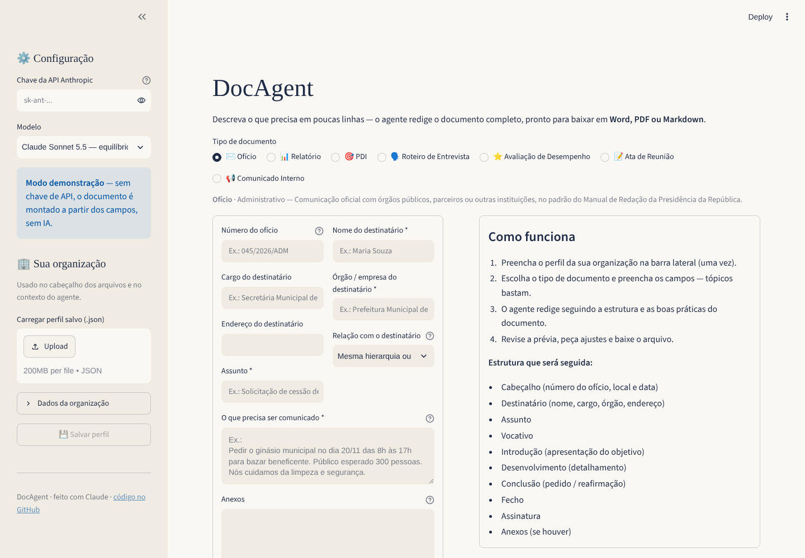
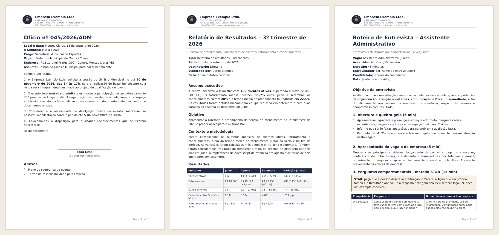
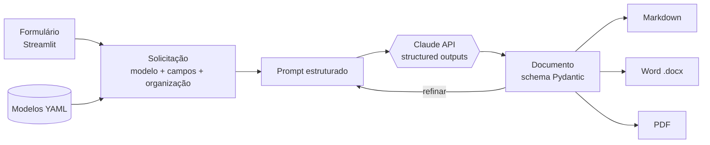

<div align="center">

# 📄 DocAgent

**Agente de IA que redige documentos empresariais completos a partir de poucas linhas**

Ofícios · Relatórios · PDIs · Roteiros de entrevista · Avaliações de desempenho · Atas · Comunicados<br>
Exporta em **Word**, **PDF** e **Markdown**, com o cabeçalho e o logo da sua organização.

[](https://github.com/tdlima/agente-documentos-ia/actions/workflows/ci.yml)


-1F2A44)




</div>

---

## O problema

Em qualquer empresa, ONG ou órgão público, horas são gastas toda semana redigindo os mesmos tipos de documento: o ofício para a prefeitura, o relatório do trimestre, o PDI do colaborador, o roteiro da próxima entrevista. O conteúdo muda; a estrutura, as boas práticas e a formatação são sempre as mesmas.

## A solução

O **DocAgent** separa as duas coisas:

- **O que é fixo** (estrutura, normas, boas práticas e formatação) fica em **modelos YAML** e nos **exportadores**.
- **O que muda** (os fatos do dia) é informado em um formulário simples, em tópicos.
- **O agente** (Claude, da Anthropic) une os dois e redige o documento completo, sem inventar dados, e aponta o que precisa ser conferido antes do uso.

<div align="center">

<br><sub>Ofício, Relatório e Roteiro de Entrevista exportados em PDF (<a href="exemplos/">entrada, prompt, resposta e arquivos em /exemplos</a>)</sub>
</div>

## Funcionalidades

| | |
|---|---|
| 🧠 **Redação com IA** | Claude redige seguindo a estrutura e as instruções de cada tipo de documento. |
| 🧱 **Saída estruturada** | A resposta é validada contra um schema Pydantic (*structured outputs*), sem depender de “parsear texto”. |
| 🔁 **Refinamento em conversa** | “Deixe mais curto”, “inclua uma tabela de cronograma”: o agente revisa mantendo o histórico. |
| ⚠️ **Pendências** | O agente não inventa fatos: usa marcadores `[assim]` e lista o que você precisa conferir. |
| 📤 **3 formatos** | Word (.docx) editável, PDF pronto para envio e Markdown, com cabeçalho, logo e numeração de páginas. |
| 🏢 **Qualquer organização** | Perfil da organização (nome, CNPJ, endereço, logo, responsável) salvo e recarregado em JSON. |
| 🧩 **Extensível sem código** | Um novo tipo de documento é só um arquivo `.yaml`. |
| 🤖 **Também dentro do Claude** | Versão *Skill*: o próprio Claude redige e exporta, sem chave de API. |
| 🧪 **Modo demonstração** | Sem chave de API, o app funciona montando o documento a partir dos campos, ideal para testar. |

### Documentos incluídos

| Documento | Destaques do modelo |
|---|---|
| ✉️ **Ofício** | Padrão do *Manual de Redação da Presidência da República*: vocativo, fecho conforme hierarquia, anexos. |
| 📊 **Relatório** | Resumo executivo, tabelas com variações calculadas, análise e recomendações acionáveis. |
| 🎯 **PDI** | Objetivos SMART, plano de ação no modelo 70-20-10, checkpoints de 30/60/90 dias. |
| 🗣️ **Roteiro de entrevista** | Perguntas STAR por competência, tempo por etapa, grade de avaliação e cuidados legais (Lei 9.029/95). |
| ⭐ **Avaliação de desempenho** | Metas com % de atingimento, competências com evidências, feedback SCI, conceito final. |
| 📝 **Ata de reunião** | Discussões por pauta, decisões separadas, plano de ação com responsável e prazo. |
| 📢 **Comunicado interno** | O quê / por quê em 3 linhas, ações esperadas, vigência e contato. |

## Arquitetura



A peça central é o schema **`Documento`**: um título, metadados e uma lista de **blocos** genéricos (`titulo`, `paragrafo`, `lista`, `lista_numerada`, `tabela`, `destaque`, `assinatura`). Como o agente sempre devolve essa estrutura neutra, **os mesmos exportadores servem para qualquer tipo de documento**, incluindo os que você criar.

```
agente-documentos-ia/
├── app.py                      # interface Streamlit
├── src/docagent/
│   ├── agent.py                # AgenteClaude (API) e AgenteDemo (sem chave)
│   ├── prompts.py              # prompt de sistema e montagem do pedido
│   ├── models.py               # schemas Pydantic (Documento, Bloco, Organizacao...)
│   ├── registry.py             # carrega os modelos YAML
│   ├── config.py               # variáveis de ambiente
│   ├── templates/*.yaml        # um arquivo por tipo de documento
│   └── renderers/              # markdown.py · docx.py · pdf.py · tema.py
├── tests/                      # 86 testes (agente, SDK simulado, exportação, app, exemplos)
├── skill/docagent/             # versão Skill para usar dentro do Claude
├── scripts/                    # empacotar_skill.py · exportar_exemplos.py
└── exemplos/                   # entrada → prompt → resposta → DOCX/PDF/MD
```

## Como executar

**Requisitos:** Python 3.10+ e, para usar a IA, uma [chave da API da Anthropic](https://console.anthropic.com/).

```bash
git clone https://github.com/tdlima/agente-documentos-ia.git
cd agente-documentos-ia

python -m venv .venv
source .venv/bin/activate          # Windows: .venv\Scripts\activate
pip install -r requirements.txt

cp .env.example .env               # e coloque sua ANTHROPIC_API_KEY
streamlit run app.py
```

Abra `http://localhost:8501`. Sem chave, o app abre em **modo demonstração**; você também pode colar a chave na barra lateral (ela fica só na sessão).

### Configuração (`.env`)

| Variável | Padrão | Descrição |
|---|---|---|
| `ANTHROPIC_API_KEY` | – | Chave da API. Sem ela, modo demonstração. |
| `DOCAGENT_MODEL` | `claude-sonnet-5-5` | Modelo do Claude (também selecionável na interface). |
| `DOCAGENT_MAX_TOKENS` | `8000` | Limite de tokens da resposta. |
| `DOCAGENT_TEMPLATES_DIR` | – | Pasta extra com seus próprios modelos YAML. |

### Publicar no Streamlit Community Cloud

1. Faça o fork/push deste repositório.
2. Em [share.streamlit.io](https://share.streamlit.io), crie um app apontando para `app.py`.
3. Em **Settings → Secrets**, adicione `ANTHROPIC_API_KEY = "sk-ant-..."`.

## Usar dentro do Claude (Skill)

O DocAgent também roda **dentro do Claude** como uma [Skill](https://support.claude.com/en/articles/12512198-how-to-create-custom-skills). Nesse modo não há chave de API nem servidor: o próprio Claude faz a redação, guiado pelos mesmos modelos YAML e regras do app, e usa os mesmos exportadores para gerar o Word/PDF.

```bash
python scripts/empacotar_skill.py      # gera dist/docagent.zip
```

| Onde | Como instalar |
|---|---|
| **claude.ai / app desktop / Cowork** | *Personalizar → Skills* → enviar `dist/docagent.zip` e ativar (requer execução de código habilitada). |
| **Claude Code** | Descompactar em `~/.claude/skills/` (pessoal) ou `.claude/skills/` (no projeto). |

Depois é só pedir em linguagem natural, por exemplo:

> *"Faça um ofício para a Secretaria de Esportes pedindo o ginásio no dia 20/11 para um bazar beneficente. Assina João Lima, diretor administrativo."*

O Claude identifica o modelo, pergunta só o que for indispensável, redige, exporta e lista as pendências. O ZIP é montado a partir do código de `src/` (sem duplicação), e `tests/test_skill.py` instala e executa a skill em uma pasta limpa a cada teste.

## Criando um novo tipo de documento

Crie um arquivo em `src/docagent/templates/` (ou na pasta de `DOCAGENT_TEMPLATES_DIR`). Ele aparece automaticamente na interface, com formulário e exportações:

```yaml
id: proposta_comercial
nome: Proposta Comercial
icone: "💼"
ordem: 8
categoria: Comercial
descricao: Proposta de serviços com escopo, investimento e condições.
campos:
  - id: cliente
    rotulo: Cliente
    obrigatorio: true
  - id: servicos
    rotulo: Serviços e valores
    tipo: texto_longo        # texto | texto_longo | lista | selecao | data | numero
    obrigatorio: true
estrutura:
  - Apresentação
  - Escopo
  - Investimento (tabela)
  - Condições e validade
instrucoes: |
  - Monte a tabela de investimento com subtotal e total.
  - Validade padrão de 15 dias, se não informada.
```

## Exemplos de ponta a ponta

A pasta [`exemplos/`](exemplos/) mostra o caminho completo de três documentos, a partir de anotações informais como as que um usuário digitaria:

| Arquivo | Conteúdo |
|---|---|
| `entrada.json` | O que foi preenchido no formulário (ex.: *"pedir o ginasio municipal dia 20/11..."*) |
| `prompt.md` | O pedido exato que o agente envia ao modelo |
| `resposta.json` | A resposta estruturada (schema `Documento`) |
| `resposta_refinada.json` | (Ofício) a versão após um pedido de ajuste |
| `.docx` · `.pdf` · `.md` | Os arquivos exportados |

> As respostas foram redigidas pelo Claude a partir dos prompts reais do agente, e os testes garantem que `prompt.md` continua idêntico ao que o código gera. Para regenerar os arquivos: `python scripts/exportar_exemplos.py`.

## Uso como biblioteca

```python
from docagent import Organizacao, Solicitacao, criar_agente, exportar, obter_modelo

org = Organizacao(nome="Minha Empresa", cidade_uf="Belo Horizonte/MG",
                  responsavel="Ana Lima", cargo_responsavel="Diretora")
pedido = Solicitacao(
    modelo=obter_modelo("comunicado_interno"),
    valores={"para": "Todos", "assunto": "Recesso de fim de ano",
             "mensagem": "Recesso de 24/12 a 02/01; plantão no dia 30."},
    organizacao=org,
)

agente = criar_agente()                     # Claude se houver chave; senão, demo
resultado = agente.redigir(pedido)
resultado = agente.refinar(resultado, "Inclua a escala do plantão em tabela")

open("comunicado.docx", "wb").write(exportar(resultado.documento, org, "docx"))
```

## Testes e qualidade

```bash
pip install -e ".[dev]"
pytest          # 86 testes, nenhum chama a API (cliente falso)
ruff check .
```

O GitHub Actions roda lint e testes em Python 3.10–3.13 a cada push.

## Decisões técnicas

- **Structured outputs em vez de texto livre:** o modelo responde já no formato do schema `Documento` (`client.messages.parse(output_format=Documento)`), o que elimina erros de parsing e torna a exportação determinística.
- **Schema simples e sem campos opcionais:** todos os campos são obrigatórios (vazios quando não se aplicam), o que mantém o schema compatível com as restrições de *structured outputs* e previsível para o modelo.
- **Modelos como dados (YAML):** conhecimento de domínio (normas, boas práticas) fica fora do código e pode ser editado por quem não programa.
- **Histórico explícito:** o refinamento reenvia a conversa (pedido → documento → ajuste), então cada versão parte da anterior.
- **Sem dados inventados:** o prompt obriga o uso de marcadores e a listagem de pendências; a interface destaca esses pontos antes do download.

## Próximos passos

- [ ] Importar dados de planilhas (CSV/XLSX) para relatórios
- [ ] Histórico de documentos gerados
- [ ] Modelos com campos condicionais
- [ ] Assinatura digital do PDF

## Autor

**JL · Inteligência Aplicada** — automação de tarefas e assistentes com IA para empresas.
[LinkedIn](https://linkedin.com/in/jr-lima) · [GitHub](https://github.com/tdlima) · tdlima.ti@gmail.com

Licença [MIT](LICENSE).
